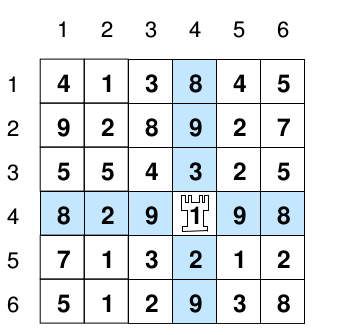

# Torre

Dada uma matriz quadrada M de números naturais, o índice i de uma certa linha e o índice j de uma certa coluna, vamos definir o peso do cruzamento da linha i com a coluna j, como sendo a soma de todos os elementos que estejam na linha i ou na coluna j, mas não nas duas. Quer dizer, excluindo o elemento que está exatamente no cruzamento! Neste problema, você deve descobrir qual é o peso mínimo entre todos os possíveis cruzamentos da matriz!

**Nota de esclarecimento:** a palavra “mínimo” no parágrafo anterior é uma inconsistência do enunciado original. Para esta questão, determine o **peso máximo**, conforme a tarefa, a saída e os exemplos apresentados a seguir.

No jogo de xadrez, a torre é uma peça que pode se mover para qualquer outra posição do tabuleiro na linha ou na coluna da posição que ela ocupa. O professor Paulo está tentando inventar um novo tipo de jogo de xadrez onde todas as peças são torres, o tabuleiro também é quadrado mas pode ter qualquer dimensão e cada posição do tabuleiro é anotada com um número inteiro positivo, como na figura abaixo.



Ele definiu o peso de uma posição (i,j) como sendo a soma de todos os números que estejam na linha i com todos os números da coluna j, mas sem somar o número que está exatamente na posição (i,j). Quer dizer, se uma torre estiver na posição (i,j), o peso da posição é a soma de todas as posições que essa torre poderia atacar.

O professor Paulo está solicitando a sua ajuda para implementar um programa que determine qual é o peso máximo entre todas as posições do tabuleiro.

No exemplo da figura acima, com um tabuleiro de dimensão seis (ou seja, seis linhas por seis colunas), o peso máximo é 67, referente à posição (4,4).

## Entrada

A primeira linha da entrada contém um inteiro N, representando a dimensão do tabuleiro.

Cada uma das N linhas seguintes contém N inteiros positivos X<sub>i</sub>, definindo os números em cada posição do tabuleiro.

## Saída

Seu programa deve produzir uma única linha, contendo um único inteiro, o peso máximo entre todas as posições do tabuleiro.

## Restrições

- 3 ≤ N ≤ 1000
- 0 < X<sub>i</sub> ≤ 100

## Informações sobre a pontuação

- Em um conjunto de casos de teste cuja soma é 60 pontos, N ≤ 300.

## Exemplos

### Exemplo 1

Entrada:

```text
6
4 1 3 8 4 5
9 2 8 9 2 7
5 5 4 3 2 5
8 2 9 1 9 8
7 1 3 2 1 2
5 1 2 9 3 8
```

Saída:

```text
67
```

### Exemplo 2

Entrada:

```text
3
5 1 1
5 2 1
8 5 5
```

Saída:

```text
20
```

## Orientação para a resposta

Grave um vídeo de até **5 minutos** explicando a lógica da solução do problema em TypeScript, utilizando uma matriz. Priorize uma explicação clara e justificada do raciocínio utilizado.

## Entrega

Envie, no campo de resposta do AVA/Moodle, **apenas o link de um vídeo não listado no YouTube**. Não é necessário enviar código.

O link deve permitir visualização pelo professor sem necessidade de solicitar autorização adicional.

*Fonte: [OBI 2015 — Programação Nível 1 — Fase 2 — Torre](https://olimpiada.ic.unicamp.br/pratique/p1/2015/f2/torre/).*
