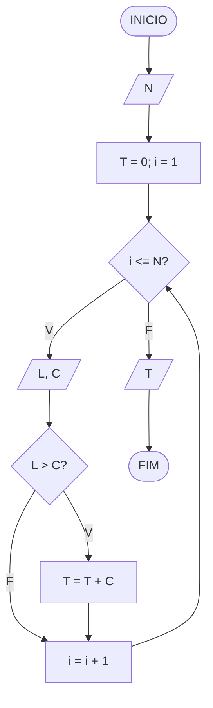
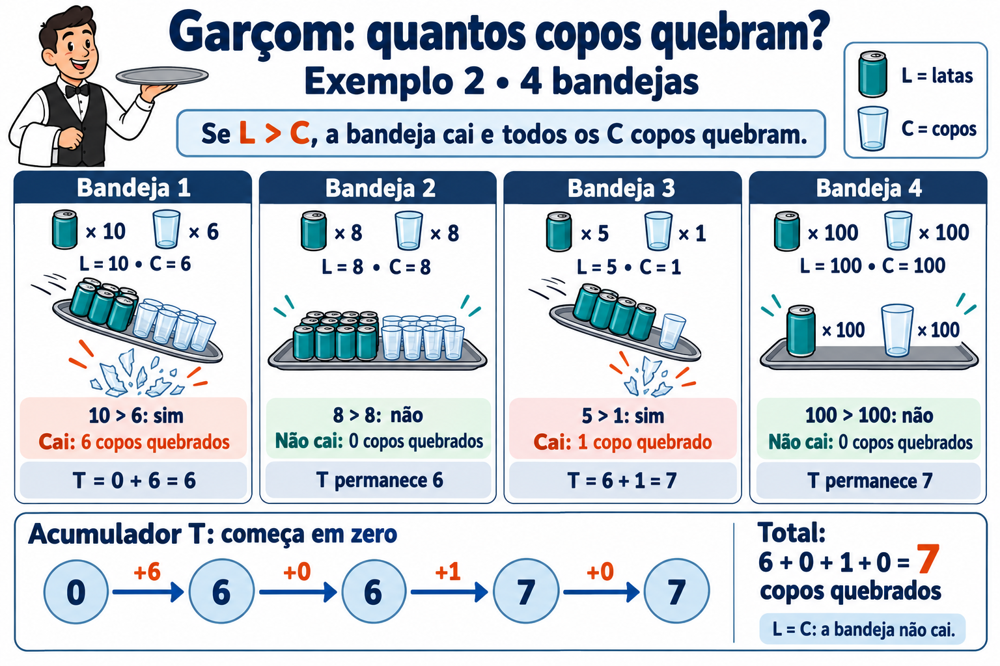

# Garçom

**OBI 2010 | Fase 1 | Programação Nível Júnior**

Fonte: [Enunciado oficial da OBI](https://olimpiada.ic.unicamp.br/pratique/pj/2010/f1/garcom/).

Parte do treinamento de um novo garçom é carregar uma grande bandeja com várias latas de bebidas e copos e entregá-las todas numa mesa do restaurante. Durante o treinamento é comum que os garçons deixem cair as bandejas, quebrando todos os copos.

A SBC (Sociedade Brasileira de Copos) analisou estatísticas do treinamento de diversos garçons e descobriu que os garçons em treinamento deixam cair apenas bandejas que têm mais latas de bebidas que copos. Por exemplo, se uma bandeja tiver 10 latas e 4 copos, certamente o garçom em treinamento a deixará cair, quebrando os 4 copos. Já se a bandeja tiver 5 latas e 6 copos, ele conseguirá entregá-la sem deixar cair.

Escreva um programa que, dado o número de latas e copos em cada bandeja que o garçom tentou entregar, imprime o total de copos que ele quebrou.

### Entrada

A primeira linha da entrada contém um inteiro N representando o número de bandejas que o garçom tentou entregar. As N linhas seguintes representam as N bandejas. Cada linha contém dois inteiros L e C, indicando o número de latas e o número de copos naquela bandeja, respectivamente.

### Saída

Seu programa deve imprimir uma única linha, contendo um único inteiro, indicando o número total de copos que o garçom quebrou.

### Exemplos

| **Entrada** | **Saída** |
| --- | --- |
| `3` `10 5` `6 8` `3 3` | `5` |
| `4` `10 6` `8 8` `5 1` `100 100` | `7` |

## Fluxograma

Use o fluxograma para organizar a solução: `N` é a quantidade de bandejas, `i` identifica a bandeja atual, `L` e `C` são as quantidades de latas e copos, e `T` acumula o total de copos quebrados. Considere entradas numéricas válidas.

## Ideia do algoritmo

Leia a quantidade de bandejas `N` e inicialize o total de copos quebrados `T` com zero. Use o contador `i`, começando em 1, para processar uma bandeja por repetição, enquanto `i <= N`.

Em cada repetição, leia as quantidades de latas `L` e de copos `C`. Se `L > C`, há mais latas que copos: a bandeja cai e todos os seus `C` copos quebram. Por isso, some `C` ao acumulador `T`. Se `L <= C`, a quantidade de latas é menor ou igual à de copos: o garçom entrega a bandeja sem deixá-la cair e nenhum copo dessa bandeja quebra. Por isso, `T` permanece igual. Em ambos os casos, incremente `i` para avançar para a próxima bandeja.

Depois de processar as `N` bandejas, exiba `T`. Basta manter as quantidades da bandeja atual e o total acumulado, sem armazenar os dados das bandejas anteriores.

