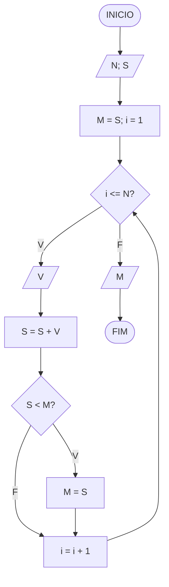
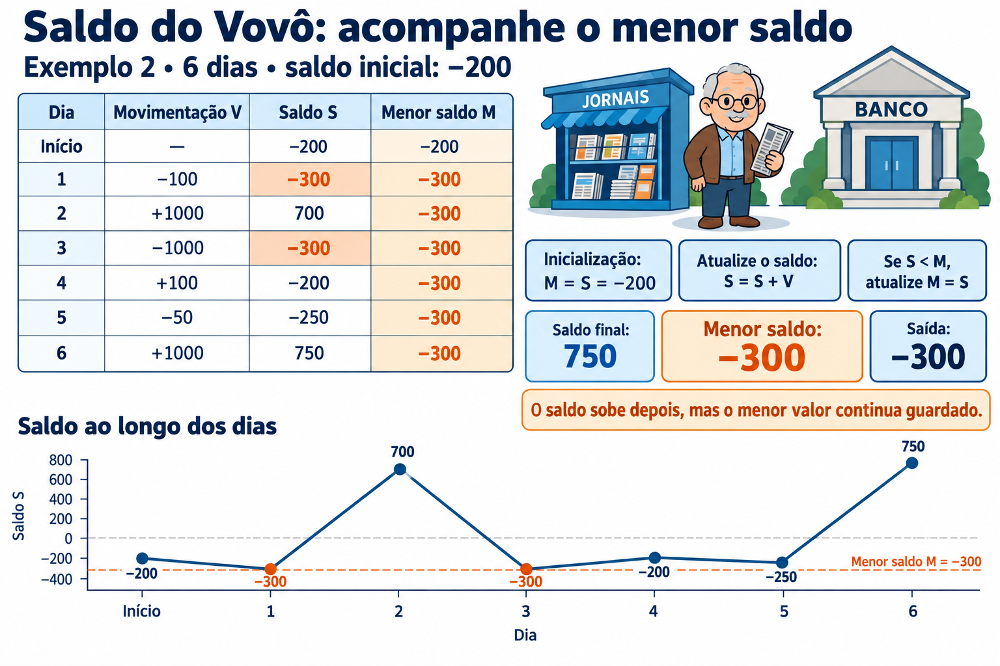

# Saldo do Vovô

**OBI 2013 | Fase 1 | Programação Nível Júnior**

Fonte: [Enunciado oficial da OBI](https://olimpiada.ic.unicamp.br/pratique/pj/2013/f1/saldo/).

## Enunciado resumido

Vovô João realiza depósitos e retiradas em sua conta. Dados o saldo inicial e as movimentações diárias, determine o menor saldo observado no período.

### Entrada

A primeira linha contém `N`, a quantidade de dias, e `S`, o saldo inicial. Cada uma das próximas `N` linhas contém uma movimentação: positiva para depósito e negativa para retirada.

### Saída

Imprima o menor saldo observado.

### Restrições

- `1 <= N <= 30`.
- Saldo inicial e movimentações entre `-1000` e `1000`.

### Exemplos

| **Entrada** | **Saída** |
| --- | --- |
| `3 1000` `100` `-800` `50` | `300` |
| `6 -200` `-100` `1000` `-1000` `100` `-50` `1000` | `-300` |

Nas soluções para o TypeScript Playground, informe um número por `prompt`.

## Fluxograma

`V` é a movimentação; `S`, o saldo atual; `M`, o menor saldo; `i`, o dia atual. Considere entradas válidas.

## Ideia do algoritmo

Leia `N` e `S`. Inicialize `M = S`, incluindo o saldo inicial na comparação; inicializar com zero produziria erros em períodos com saldos sempre positivos.

A cada dia, leia `V` e atualize `S = S + V`. Se `S < M`, guarde o novo mínimo em `M`. Um depósito posterior pode aumentar `S`, mas não apaga o mínimo já observado.

No segundo exemplo, os saldos são `-200 → -300 → 700 → -300 → -200 → -250 → 750`. O menor é `-300`, embora o saldo final seja `750`. Exiba `M`. Não é necessário armazenar o histórico.

