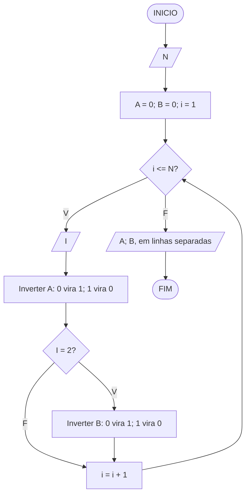
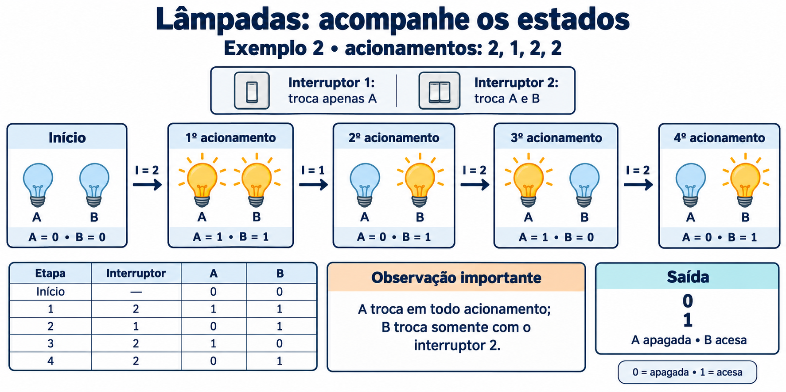

# Lâmpadas

**OBI 2016 | Fase 1 | Programação Nível Júnior**

Fonte: [Enunciado oficial da OBI](https://olimpiada.ic.unicamp.br/pratique/pj/2016/f1/lampadas/).

## Enunciado resumido

Duas lâmpadas, A e B, começam apagadas. O interruptor 1 troca apenas o estado de A; o interruptor 2 troca o estado de ambas. Determine os estados finais após os acionamentos informados.

### Entrada

A primeira linha contém `N`, a quantidade de acionamentos. A segunda contém `N` valores, iguais a 1 ou 2.

### Saída

Imprima o estado de A e depois o de B, em linhas separadas: 0 indica apagada e 1 indica acesa.

### Restrições

- `1 <= N <= 100000`.

### Exemplos

| **Entrada** | **Saída** |
| --- | --- |
| `3` `1 2 2` | `1` `0` |
| `4` `2 1 2 2` | `0` `1` |

Nas soluções para o TypeScript Playground, informe um número por `prompt`.

## Fluxograma

`I` identifica o interruptor; `i`, o acionamento atual. Considere entradas válidas.

## Ideia do algoritmo

Inicialize `A` e `B` com zero. Para cada acionamento, leia `I` e inverta `A`, pois os dois interruptores alteram essa lâmpada. Use uma condição: se o estado era zero, passa a um; caso contrário, passa a zero. Inverta `B` somente quando `I = 2`.

No segundo exemplo, os estados `(A, B)` evoluem assim: `(0, 0) → (1, 1) → (0, 1) → (1, 0) → (0, 1)`. Exiba cada estado final em sua própria linha. Basta guardar os estados atuais, sem armazenar os acionamentos.

