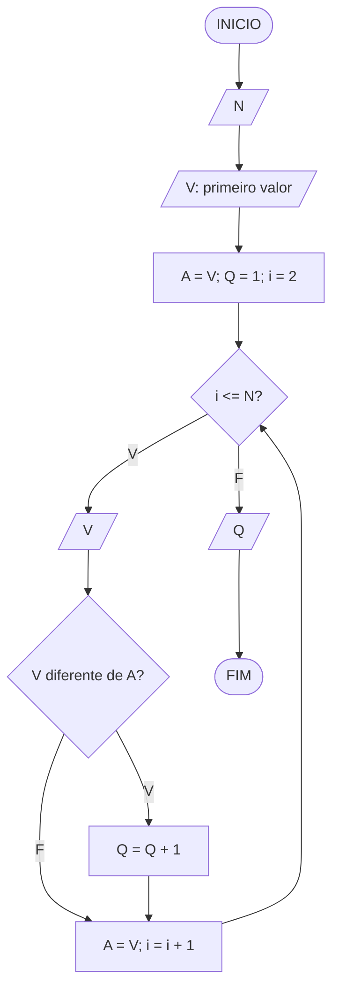
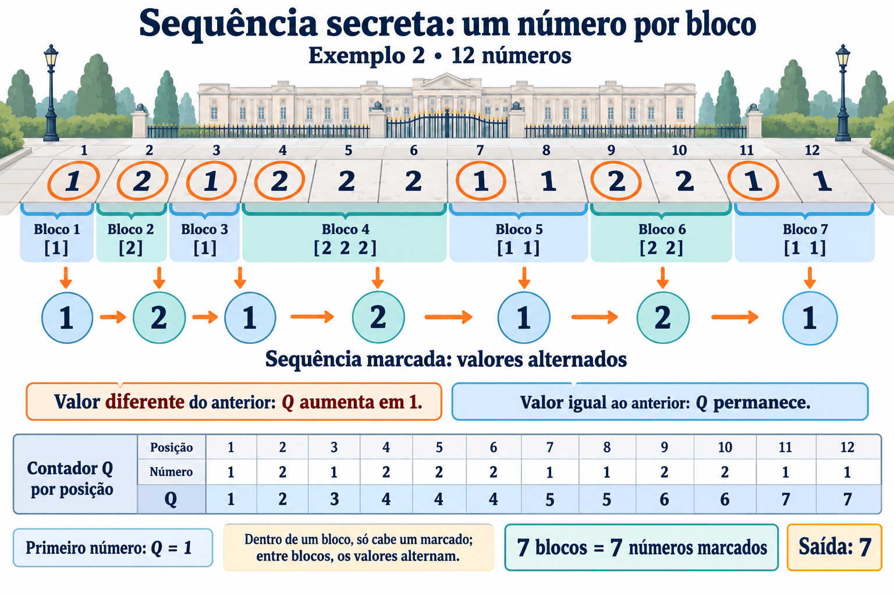

# Sequência Secreta

**OBI 2019 | Fase 1 | Programação Nível Júnior**

Fonte: [Enunciado oficial da OBI](https://olimpiada.ic.unicamp.br/pratique/pj/2019/f1/secreta/).

## Enunciado resumido

Uma sequência contém apenas 1 e 2, começa e termina com 1 e possui pelo menos um 2. Marque a maior quantidade possível de números, preservando a ordem, sem que valores consecutivos entre os marcados sejam iguais.

### Entrada

Leia `N`, o tamanho da sequência, seguido de `N` linhas, cada uma com um valor.

### Saída

Imprima a quantidade máxima de números marcados.

### Restrições

- `3 <= N <= 500`.
- Cada valor é 1 ou 2.

### Exemplos

| **Entrada** | **Saída** |
| --- | --- |
| `5` `1` `1` `1` `2` `1` | `3` |
| `12` `1` `2` `1` `2` `2` `2` `1` `1` `2` `2` `1` `1` | `7` |
| `3` `1` `2` `1` | `3` |

Nas soluções para o TypeScript Playground, informe um número por `prompt`.

## Fluxograma

`V` é o valor atual; `A`, o anterior; `Q`, a quantidade marcada; `i`, a posição atual. Considere entradas válidas.

## Ideia do algoritmo

Divida mentalmente a sequência em blocos de valores iguais. Podemos marcar um número de cada bloco: dois do mesmo bloco ficariam iguais e consecutivos entre os marcados. Os blocos vizinhos alternam valores; portanto, escolher um por bloco alcança o máximo.

Leia o primeiro valor, guarde-o em `A` e inicialize `Q = 1`. Para cada novo `V`, incremente `Q` somente se `V` diferir de `A`. Depois, atualize `A = V`.

No segundo exemplo, os blocos são `1 | 2 | 1 | 2 2 2 | 1 1 | 2 2 | 1 1`. São sete blocos: a resposta é 7. Basta manter o valor anterior e o contador.

