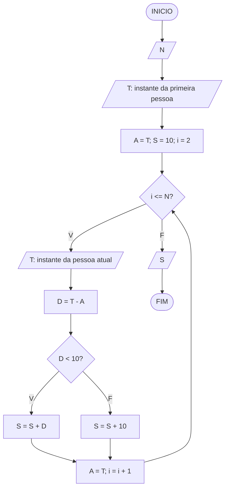
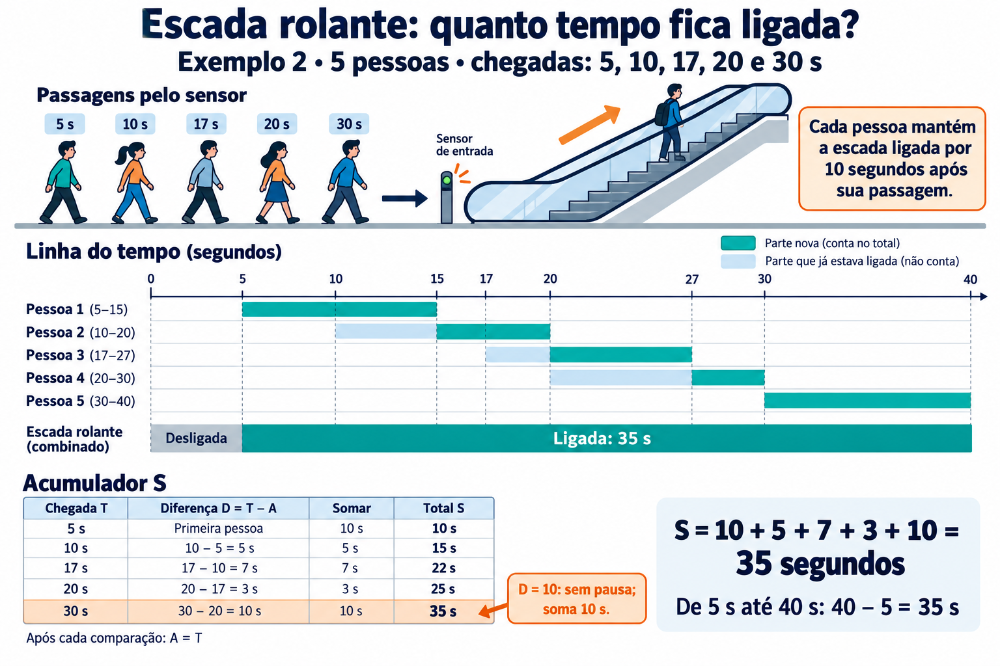

# Escada Rolante

**OBI 2010 | Fase 2 | Programação Nível Júnior**

Fonte: [Enunciado oficial da OBI](https://olimpiada.ic.unicamp.br/pratique/pj/2010/f2/escada/).

O Shopping Boas Compras (SBC), através de sua política ambiental, está preocupado com o consumo de energia e resolveu trocar todas as escadas rolantes por modelos mais modernos, que se desligam caso ninguém esteja utilizando, poupando energia.

A nova escada rolante possui um sensor no início. Toda vez que ela está vazia e alguém passa pelo sensor, a escada começa a funcionar, parando de funcionar novamente após 10 segundos se ninguém mais passar pelo sensor. Estes 10 segundos representam o tempo suficiente para levar alguém de um nível ao outro. Preocupados em saber exatamente quanto de energia o shopping está economizando, o gerente pediu sua ajuda. Como eles sabem qual era o consumo da escada rolante antiga, eles te pediram para calcular o tempo que a nova escada ficou funcionando.

Dados os instantes, em segundos, em que passaram pessoas pela escada rolante, você deve calcular quantos segundos ela ficou ligada.

### Entrada

A primeira linha da entrada contém um inteiro N que indica o número de pessoas que o sensor detectou. As N linhas seguintes representam o instante em que a i-ésima pessoa passou pelo sensor e contêm um inteiro T. Os tempos estão em ordem crescente, sem repetições.

### Saída

Seu programa deve imprimir uma única linha, contendo o tempo que a escada rolante ficou ligada.

### Informações sobre a pontuação

- Em um conjunto de casos de teste que totaliza 30 pontos, a primeira pessoa passa pelo sensor no tempo 0.

### Exemplos

| **Entrada** | **Saída** |
| --- | --- |
| `3` `0` `10` `20` | `30` |
| `5` `5` `10` `17` `20` `30` | `35` |
| `3` `1` `2` `3` | `12` |

## Fluxograma

Use o fluxograma para organizar a solução: `N` é a quantidade de pessoas, `i` identifica a pessoa atual, `T` é seu instante de passagem, `A` guarda o instante da pessoa anterior, `D` é a diferença entre os dois instantes e `S` acumula o tempo de funcionamento da escada. Considere entradas numéricas válidas, com os instantes em ordem crescente, sem repetições.

## Ideia do algoritmo

Cada passagem pelo sensor mantém a escada ligada até 10 segundos após aquele instante. Leia a quantidade de pessoas `N` e o instante `T` da primeira passagem. Essa primeira pessoa faz a escada funcionar por 10 segundos; por isso, inicialize o acumulador `S` com 10 e guarde seu instante em `A`. O tempo anterior à primeira passagem não entra na soma, pois a escada estava desligada.

Use o contador `i`, começando em 2, para processar as demais pessoas enquanto `i <= N`. Em cada repetição, leia o instante atual `T` e calcule `D = T - A`, que representa quantos segundos se passaram desde a pessoa anterior.

Se `D < 10`, a pessoa atual chega enquanto a escada ainda está ligada. Os períodos de funcionamento das duas pessoas se sobrepõem, e a nova passagem adia o desligamento em apenas `D` segundos. Por isso, some `D` a `S`, evitando contar novamente o tempo já incluído. Por exemplo, se uma pessoa passa no instante 5 e a seguinte no instante 8, o desligamento passa de 15 para 18: são apenas 3 segundos adicionais.

Se `D >= 10`, os períodos de funcionamento das duas pessoas não se sobrepõem. A pessoa atual acrescenta um período completo de 10 segundos; por isso, some 10 a `S`. Quando `D > 10`, a escada ficou desligada entre as duas utilizações, e esse intervalo não deve ser somado. Quando `D = 10`, a pessoa chega exatamente no instante previsto para o desligamento e acrescenta mais 10 segundos, sem intervalo de inatividade.

Em ambos os casos, atualize `A` com `T`, pois a pessoa atual será a anterior na próxima comparação, e incremente `i` para avançar para a próxima pessoa. Ao terminar, exiba `S`, o total de segundos em que a escada ficou ligada. Basta guardar o instante anterior e o total acumulado, sem armazenar todos os instantes. Se houver apenas uma pessoa, o laço não será executado e o resultado será 10 segundos.

