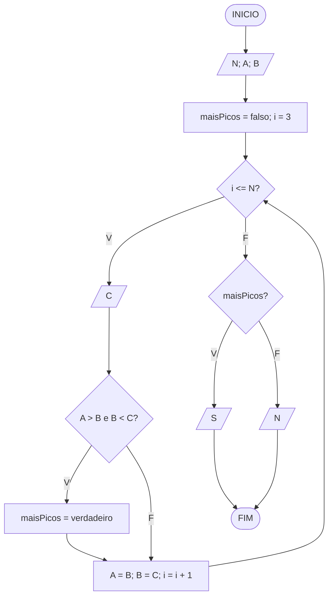
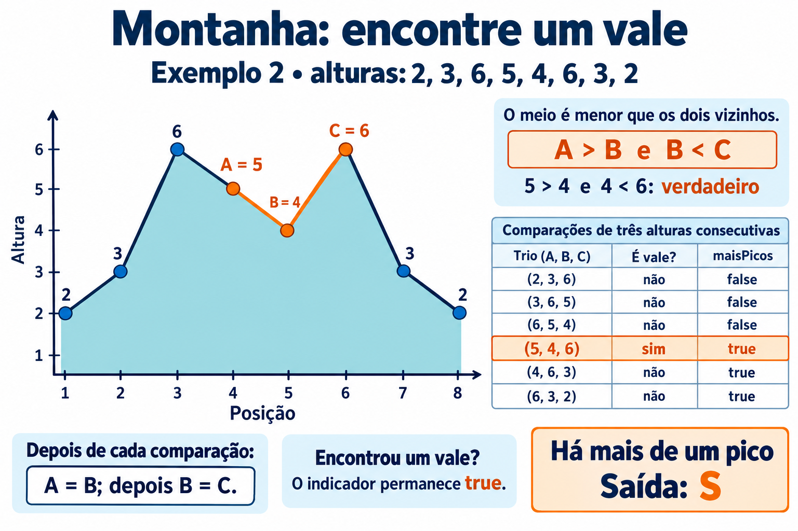

# Montanha

**OBI 2017 | Fase 2 | Programação Nível Júnior**

Fonte: [Enunciado oficial da OBI](https://olimpiada.ic.unicamp.br/pratique/pj/2017/f2/montanha/).

## Enunciado resumido

Uma sequência de alturas, sem valores vizinhos iguais, representa uma montanha. O critério do problema indica mais de um pico quando existem três alturas consecutivas cuja altura central é menor que as outras duas.

### Entrada

A primeira linha contém `N`. A segunda contém as `N` alturas.

### Saída

Imprima `S` se existir esse vale; caso contrário, imprima `N`.

### Restrições

- `3 <= N <= 1000`.
- Alturas entre 1 e 1000, sem vizinhos iguais.

### Exemplos

| **Entrada** | **Saída** |
| --- | --- |
| `8` `2 3 5 6 7 5 4 2` | `N` |
| `8` `2 3 6 5 4 6 3 2` | `S` |

Nas soluções para o TypeScript Playground, informe um número por `prompt`.

## Fluxograma

`A`, `B` e `C` são alturas consecutivas; `i` identifica a posição de `C`. Considere entradas válidas.

## Ideia do algoritmo

Leia as duas primeiras alturas em `A` e `B`; inicialize `maisPicos = false`. A partir da terceira, leia `C`. Se `A > B` e `B < C`, encontramos um vale: atribua `true` a `maisPicos`.

Desloque a comparação com `A = B` e depois `B = C`. A ordem importa: preserva as duas últimas alturas para a próxima leitura. Uma vez verdadeiro, o indicador permanece verdadeiro, mesmo que os próximos trios não formem vales.

No segundo exemplo, o trio `5, 4, 6` satisfaz `5 > 4` e `4 < 6`; a saída é `S`. Ao terminar, exiba `S` ou `N` conforme o indicador. Basta guardar três alturas, sem vetor ou contagem de picos.

